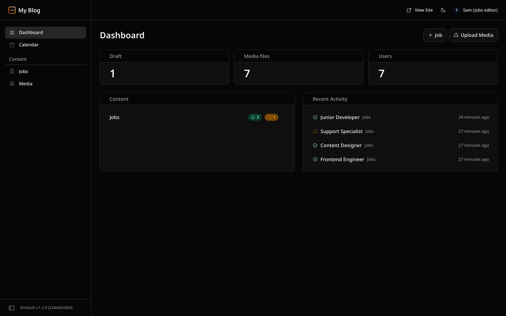
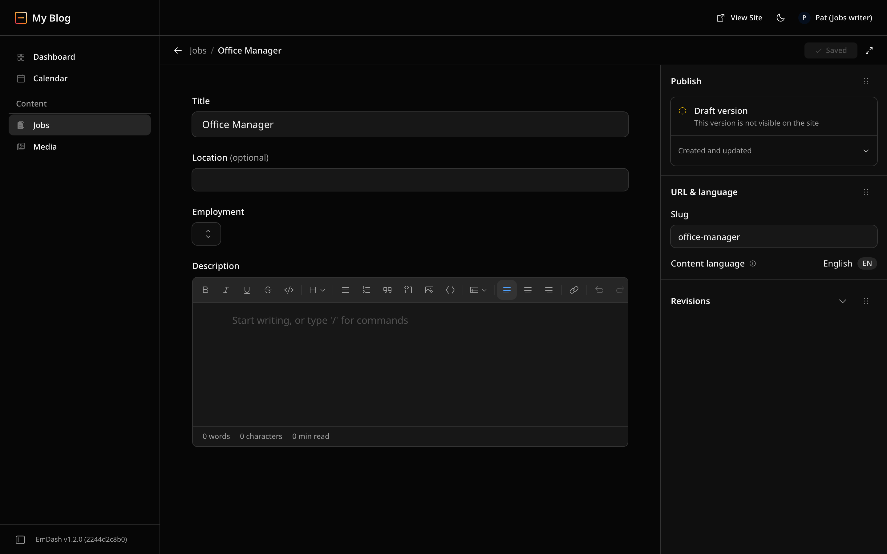
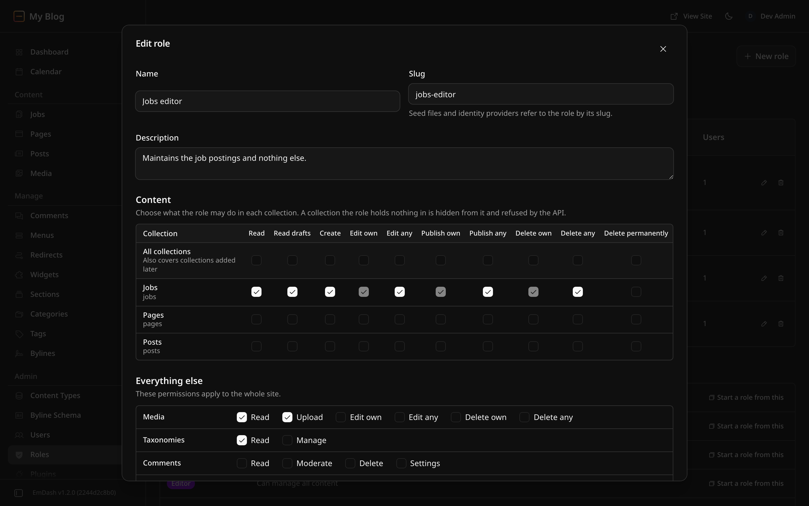

# Custom roles: proof of concept findings

This prototype tests the design proposed in emdash-cms/emdash#3717 (custom
roles and collection-scoped permissions) against EmDash at upstream commit
`30604dcb05`. It is a feasibility study, not an implementation pull request.
The demo site in this directory runs it; [README.md](README.md) explains how
to start it and which personas to sign in as.

## What the prototype builds

| Area         | What it does                                                                                                                                                                                                                                                                                                                                                                                                                                                                                                                                                           | Where                                         |
| ------------ | ---------------------------------------------------------------------------------------------------------------------------------------------------------------------------------------------------------------------------------------------------------------------------------------------------------------------------------------------------------------------------------------------------------------------------------------------------------------------------------------------------------------------------------------------------------------------- | --------------------------------------------- |
| Check        | `hasPermission(actor, permission, { collection })`. A built-in role answers from the permission map as before. A custom role answers from its grants. A grant limited to collections counts only when the check names one of them.                                                                                                                                                                                                                                                                                                                                     | `packages/auth/src/rbac.ts`                   |
| Grants       | Unknown names are dropped, `_any` adds the matching `_own`, `content:edit_own` adds `content:edit_own_drafts`, managing an area adds reading it, and the permissions that reach past the content model stay with the built-in Admin role: `users:*`, `auth:manage_connections`, `settings:manage`, `plugins:manage`, `schema:manage`, `import:execute`, `backups:manage` and `transfer:*`.                                                                                                                                                                             | `normalizeGrants` in `rbac.ts`                |
| Stored level | `users.role` keeps a built-in level for code that compares numbers: the highest built-in role whose permissions the custom role holds for all collections, at least Subscriber. Changing a role rewrites the level of its users, invites and signup domains in one transaction, or one atomic batch on D1; assigning a role reads the level inside the write that stores it. External-auth role sync leaves users with a custom role alone.                                                                                                                            | `compatibilityLevel`, `api/handlers/roles.ts` |
| Schema       | Migration 092 adds `_emdash_roles` and nullable `role_id` columns on `users` and `auth_tokens` and `default_role_id` on `allowed_domains`, each a foreign key to the roles table.                                                                                                                                                                                                                                                                                                                                                                                      | `database/migrations/092_custom_roles.ts`     |
| Loading      | The query that loads the signed-in user joins the role, so a custom role costs no extra query. While migration 092 is still pending, the lookup falls back to the plain user select and tries the join again a minute later.                                                                                                                                                                                                                                                                                                                                           | `adapters/kysely.ts`                          |
| REST         | Every content route passes its collection to the check, including bulk tagging (per item) and dismissing a policy rejection. Search, the dashboard, the calendar and the reference routes narrow to the collections the role may read; a reference field into another collection is resolved with the caller's rights there, and a selection write into a collection the caller cannot read is refused before anything is looked up. A revision in such a collection is answered like a missing one. | `astro/routes/api/**`                         |
| MCP          | The 53 `requireRole` calls became the permission the matching REST route checks, with the tool's collection. The read tools that had no check now check their read permission.                                                                                                                                                                                                                                                                                                                                                                                         | `mcp/server.ts`                               |
| Plugins      | Plugin routes keep the caller's custom role. An editor extension is checked against the collection of the entry it runs on.                                                                                                                                                                                                                                                                                                                                                                                                                                            | `plugins/http-route-dispatch.ts`              |
| Admin API    | `GET /auth/me` returns `customRole`, `permissions` and `collections`. `/_emdash/api/admin/roles` lists, creates, updates and deletes roles. Users and invites accept a `roleId`.                                                                                                                                                                                                                                                                                                                                                                                       | `astro/routes/api/**`                         |
| Admin UI     | One `useCan` hook replaces the role numbers in the sidebar, command palette, dashboard, content list, editor, media library, calendar, comments and settings. A Roles page edits roles with a permission matrix.                                                                                                                                                                                                                                                                                                                                                       | `packages/admin/src`                          |
| Seed         | A `roles` section, applied with the rest of the structure and written by `emdash export-seed`.                                                                                                                                                                                                                                                                                                                                                                                                                                                                         | `seed/*`, `cli/commands/export-seed.ts`       |

## What it shows

### Built-in roles keep their behavior

A custom role that holds exactly a built-in role's permissions answers every
check the way the built-in role does, in every collection, and is stored at
that role's level (`packages/auth/src/custom-roles.test.ts`). The existing
tests pass unchanged where they test behavior: the full core suite (9,844
tests) and the admin suites listed under Verification.

A few admin test fixtures changed. They described users as `{ id, role }`,
which the real `/auth/me` no longer sends, and three of them relied on states
the server refuses (see "Admin and server disagreed" below).

### A role limited to one collection is refused everywhere else

Sam holds the `jobs-editor` role from the demo seed. On the running site:

| Request                                | Result          |
| -------------------------------------- | --------------- |
| `GET /_emdash/api/content/jobs`        | 200             |
| `GET /_emdash/api/content/posts`       | 403             |
| `POST /_emdash/api/menus`              | 403             |
| Publishing a job someone else drafted  | 200             |
| Opening `/_emdash/admin/content/posts` | "Access Denied" |

The same cases run as an integration test against a real database, through
the REST routes and the MCP tools (`packages/core/tests/integration/auth/custom-roles.test.ts`,
15 tests).

### The admin offers only what the server allows

Pat holds `jobs-writer`: create jobs and edit their own job drafts
(`content:edit_own_drafts` in Jobs only), no publishing. Pat's own draft is
editable and shows no Publish or Schedule button, and a direct publish request
is refused with 403. An entry Pat doesn't own opens read-only, and so does
Pat's own job once a jobs editor has published it.

The built-in roles benefit too. A Contributor opening someone else's post, or
their own post after it was published, now gets a read-only editor. Upstream,
the same Contributor sees Save, Publish, Schedule and Move to Trash, and the
first edit fails with "Autosave failed".

### Custom roles cost no extra query

Query counts per request after a warm-up, measured on the demo site with
`EMDASH_QUERY_LOG=1`:

| Request                         | Anonymous | Admin | Editor | Contributor | `jobs-editor` | `site-editor` |
| ------------------------------- | --------- | ----- | ------ | ----------- | ------------- | ------------- |
| `GET /`                         | 6         | 7     | 7      | 7           | 7             | 7             |
| `GET /jobs`                     | 8         | 9     | 9      | 9           | 9             | 9             |
| `GET /_emdash/api/auth/me`      | (401)     | 1     | 1      | 1           | 1             | 1             |
| `GET /_emdash/api/content/jobs` | (401)     | 6     | 6      | 6           | 6             | 6             |
| `GET /_emdash/api/dashboard`    | (401)     | 14    | 14     | 14          | 10            | 14            |

The one query an authenticated page adds is the user lookup, the same as
before. It now carries the role through a join. The `jobs-editor` dashboard
is cheaper because it reads one collection instead of three. For anonymous
pages, `pnpm query-counts` reports that both the counts and the query text
match the committed SQLite snapshot.

### Roles can be managed in the admin

The Roles page lists custom roles with what they can reach and the built-in
level that older code sees. "Start a role from this" copies a built-in
role's permissions into a new role. The page works right to left
([Arabic screenshot](screenshots/11-roles-page-arabic.png)).

## Decisions the prototype had to make

- **Role row level.** The role row stores no level. The level is derived from
  the grants and stored only on the rows that reference the role.
- **Managing roles.** Listing roles needs `users:read`, changing them needs
  `users:manage`. Custom roles can't hold either, so only the built-in Admin
  manages roles.
- **Deleting a role.** Refused while a user, invite or signup domain uses it.
  The foreign keys refuse it at database level too.
- **A role reference without a row** yields no permissions. It can't be
  written while foreign keys are enforced; the test switches them off to
  reach it.
- **Early collection check.** Content routes load the entry before checking
  ownership. Without a check first, a role limited to other collections could
  tell from 404 or 403 whether an entry exists in a collection it can't reach.
  Each content route now first checks that the role holds any permission in
  the collection. Every built-in role passes that check.
- **References.** The reference routes return entries from the other side of
  a relation, so they check read access on that collection, not only on the
  one in the URL.
- **Visual editing** needs `content:edit_own` and `content:read_drafts` for
  all collections, because edit mode shows drafts on every page. A role
  limited to some collections gets no edit mode. For built-in roles the rule
  is the same as `role >= 30`.
- **Token scopes** for a custom role come from its grants: device-flow and
  authorization-code approvals, the code exchange and token refresh clamp
  with the actor instead of the stored level. It never receives `admin` or
  `mcp:tools`. Personal API tokens stay with the built-in Admin role.
- **Editor extensions** of plugins are checked against the collection of the
  entry they run on, which the host takes from its own route and the loaded
  entry. Other plugin routes have no collection, so only a site-wide grant
  satisfies them.
- **Editing one's own drafts.** `content:edit_own_drafts`, which upstream
  added at Contributor in emdash-cms/emdash#4133, can be granted per
  collection like the other content permissions, and `content:edit_own`
  includes it. Without that, a role that lists Author's permissions by name
  would be stored at Subscriber level, because Contributor's permissions now
  include the new name.
- **Collection lookups use `Object.hasOwn`.** `constructor` is a valid
  collection slug.
- **Search treats an empty collection list as all collections**, so a role
  with no readable collection gets an empty result instead.
- **A custom role cannot take a built-in role's slug**, so a later mapping
  from an identity provider by slug stays unambiguous.
- **The read-only editor** disables what writes (save, publish, schedule,
  discard, trash, restore, translate) and keeps Preview, the settings sheet,
  the revision list, compare and the translation links, which the server
  allows a reader.

## Admin and server disagreed

Gating the admin on permissions surfaced places where the 1.0 admin and
server already disagree. The prototype follows the server in each case:

- The admin loads the user list for the author picker as an Editor, but the
  endpoint is Admin-only, so Editors never get the picker on a real site.
- The admin offered Publish to an Author on an entry with no recorded author.
  The server refuses it, because an empty owner falls through to
  `content:publish_any`.
- A Contributor was offered Save and Publish on entries they can't edit.
- The Settings hub listed Self-Signup Domains, API Tokens, Email and Backups
  for everyone who could open it; the Plugins entry opened a page whose first
  request needs `plugins:read`; Duplicate was offered without the edit right
  the server checks on the source.

## Not built

- `emdash role` CLI commands.
- Role slugs in the Cloudflare Access and Atmosphere role mappings.
- Choosing a custom role as a signup domain's default role (the column
  exists; the API and admin don't offer it yet).
- Plugin page visibility by the permission of the page's route.
- A permission that limits drafts to the user's own entries.
- Co-owners (emdash-cms/emdash#4132), which would add owners to the same
  ownership check.
- Settling the MCP `media_create` level, which still differs from the REST
  upload permission; the prototype kept today's behavior.
- Site transfer import for a custom role: the import review needs the user
  list, which only the built-in Admin may read.
- Plugin surfaces (pages, widgets, sandboxed panels) are still offered to
  every role and gated by their routes.

## Verification

- `packages/auth`: the full suite (161 tests), 61 of them for the permission checks and custom-role semantics.
- `packages/core`: `tests/integration/auth/custom-roles*.test.ts` (role
  storage, collection scope on REST and MCP, references into other
  collections, token scopes, the level written on assignment, reserved
  permissions, the data layer on SQLite and Postgres) and
  `tests/unit/astro/custom-roles-*.test.ts` (external-auth sync, a pending
  migration 092), plus the unit, integration, MCP, seed, database, plugin and
  API suites the change touches; `tests/workerd/custom-roles-d1.test.ts` on
  D1.
- `packages/admin`: the sidebar, command palette, users, settings, dashboard,
  media, calendar, editor and router suites.
- `pnpm query-counts` for SQLite and D1: counts and query text match the
  snapshots.
- The PostgreSQL parity run of every test file the change touches, and the
  D1 (workerd) suite.
- Type-aware lint: no diagnostics.
- Manual walkthrough of every persona on the demo site, in English and Arabic.
